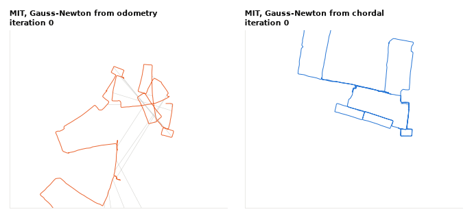
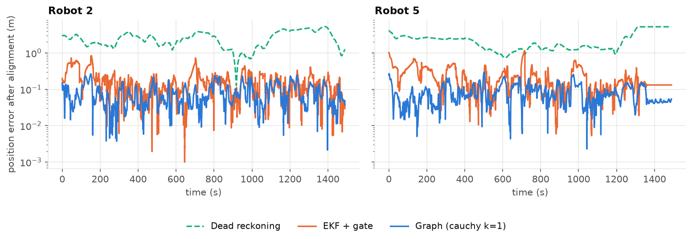
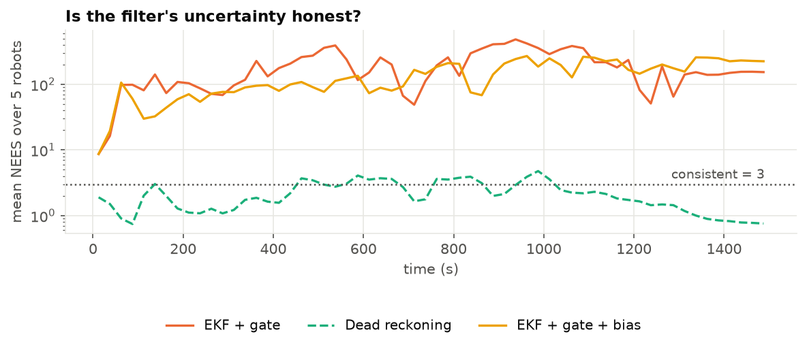
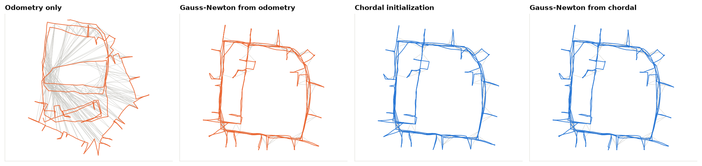
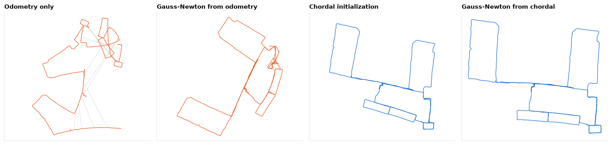
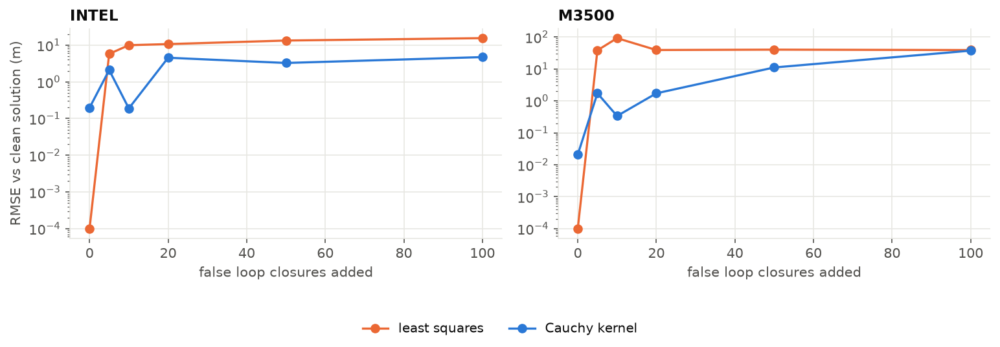

# SLAM from Scratch: EKF vs Graph Optimization on Real Robots

[](https://github.com/MohnishM21/slam-from-scratch/actions/workflows/tests.yml)

EKF-SLAM and sparse graph SLAM, written from scratch in NumPy and SciPy and run on
real data:
- **five ground robots** from the UTIAS MRCLAM dataset, scored against a 10-camera
  motion-capture system;
- **three standard pose-graph benchmarks**: Intel Research Lab, MIT Killian Court and M3500.

No SLAM library is used. The solver, Jacobians, filter, initialization and
robust kernels are all in [`src/slam`](src/slam).

<picture>
  <source media="(prefers-color-scheme: dark)" srcset="results/figures/mit_iterations_dark.gif">
  
</picture>

*MIT Killian Court. Left: Gauss-Newton started from odometry stops in a local
minimum (chi-square 771). Right: started from a chordal initialization, it reaches
a 19 times lower cost (41.2) in 6 iterations.*

## Findings

1. **Graph SLAM beats the EKF on every robot.** On the four held-out robots it
   averages 0.11 m of trajectory error, against 0.26 m for the best EKF variant
   and 2.57 m for dead reckoning. Its maps have 6 to 11 cm RMSE against the
   surveyed landmarks.
2. **The EKF is overconfident.** Its normalized estimation error squared (NEES)
   should average 3 if its covariance is honest; on these robots it ranges from
   5 to 869. Overconfidence then turns outlier gating against it: once the filter
   believes a wrong heading, it rejects the correct measurements.
3. **No EKF variant works on all five robots.** Estimating a turn-rate bias cuts
   robot 5's unaligned error from 2.85 to 0.38 m (its odometry over-reports its
   turning by about 20% for a minute) but raises robot 3's from 0.29 to 1.64 m. Gating fixes some robots and hurts others. Graph SLAM can
   revisit past poses, so one bad stretch does not poison the rest.
4. **Initialization decides pose-graph optimization.** On MIT Killian Court,
   Gauss-Newton from odometry stops at a local minimum with 19 times the cost of
   the solution reached from a chordal initialization.
5. **Gauss-Newton is not a descent method, and here that helps.** On INTEL its
   first step raises the cost from 5.1 million to 160 million and it still
   converges in 6 iterations. Levenberg-Marquardt, which only accepts cost
   decreases, needs 300 iterations and is not done.
6. **Robust kernels matter, but they are not a guarantee.** 8 to 16% of MRCLAM
   sightings are more than five robust standard deviations off, and a Cauchy
   kernel cuts graph SLAM's error from 0.17 to 0.11 m. On the benchmarks, five
   false loop closures move the plain least-squares map by 5.8 m (INTEL) and
   38 m (M3500); the Cauchy kernel limits that to 2.1 and 1.7 m. But it is
   erratic, because from a drifted start even true loop closures look like
   outliers. It handles 10 false loops better than 5, and on M3500 it fails
   completely at 100. A real system would also reject inconsistent loop
   closures before they reach the optimizer.
7. **The dataset has an error.** In MRCLAM dataset 1 the surveyed positions of
   two landmarks are swapped (details below).

## Results on real robots (MRCLAM)

Trajectory RMSE in metres after rigid alignment to ground truth, unaligned in
brackets. The noise models and the robust kernel were chosen on robot 1 only;
robots 2 to 5 are a held-out test.

| Method | Robot 1 | Robot 2 | Robot 3 | Robot 4 | Robot 5 | Mean, robots 2-5 |
|---|---:|---:|---:|---:|---:|---:|
| Dead reckoning | 2.82 (5.08) | 2.86 (4.50) | 3.56 (6.32) | 1.24 (1.66) | 2.63 (6.19) | **2.57** |
| EKF | 0.30 (0.35) | 0.16 (0.73) | 0.23 (0.68) | 0.40 (0.95) | 0.37 (1.63) | **0.29** |
| EKF + gate | 0.34 (0.41) | 0.21 (0.37) | 0.17 (0.29) | 0.42 (0.64) | 0.27 (2.85) | **0.27** |
| EKF + gate + bias | 0.33 (0.46) | 0.22 (0.40) | 0.26 (1.64) | 0.38 (0.61) | 0.17 (0.38) | **0.26** |
| Graph (least squares) | 0.12 (0.24) | 0.10 (0.19) | 0.15 (0.66) | 0.20 (0.34) | 0.23 (1.03) | **0.17** |
| Graph (Cauchy, k = 1) | 0.08 (0.19) | 0.10 (0.18) | 0.09 (0.60) | 0.16 (0.25) | 0.10 (0.26) | **0.11** |

**Why aligned errors.** SLAM cannot observe the global frame beyond the first
pose: a small heading error in the first seconds rotates the whole map. Robot
5's gated EKF is 2.85 m off unaligned, but only 0.27 m once a 48° rotation of
the whole map is removed. Aligning first, as the TUM RGB-D benchmark does, separates
"is the map the right shape" from "is it pointing the right way". Both numbers
are reported.

<picture>
  <source media="(prefers-color-scheme: dark)" srcset="results/figures/mrclam_error_time_dark.png">
  
</picture>

<picture>
  <source media="(prefers-color-scheme: dark)" srcset="results/figures/mrclam_nees_dark.png">
  
</picture>

*Dead reckoning stays near the consistent value of 3, because the noise model was
calibrated to make it so. The EKF's covariance shrinks with every update while
its real error does not, so its NEES climbs into the hundreds.*

## Results on pose-graph benchmarks

| Dataset | Poses | Edges | Odometry start, GN | Chordal start, GN | Chordal start, LM |
|---|---:|---:|---|---|---|
| INTEL | 1,228 | 1,483 | 215.83 (6 its, 0.13 s) | 215.83 (4 its, 0.11 s) | 215.83 (178 its, 3.8 s) |
| MIT Killian Court | 808 | 827 | **770.66** (26 its, 0.26 s) | 41.16 (6 its, 0.06 s) | 41.16 (17 its, 0.16 s) |
| M3500 | 3,500 | 5,453 | 137.91 (7 its, 1.4 s) | 137.91 (4 its, 0.61 s) | 137.91 (12 its, 2.2 s) |

Final chi-square, iterations and wall time (Python, one core). Full table in
[`results/pose_graphs.md`](results/pose_graphs.md).

<picture>
  <source media="(prefers-color-scheme: dark)" srcset="results/figures/pose_graph_intel_dark.png">
  
</picture>

<picture>
  <source media="(prefers-color-scheme: dark)" srcset="results/figures/pose_graph_mit_dark.png">
  
</picture>

<picture>
  <source media="(prefers-color-scheme: dark)" srcset="results/figures/outliers_dark.png">
  
</picture>

*False loop closures injected into INTEL and M3500, solved from odometry.
Error is measured against the solution without them (shown at a floor of
0.1 mm where the two agree exactly). Note the Cauchy kernel's own 0.20 m bias
on INTEL with no outliers: with k = 1 it also down-weights some true loop closures.*

## How it works

**Solver** ([`factor_graph.py`](src/slam/factor_graph.py)). Unknowns are poses
(x, y, θ) and landmarks (x, y). There are three factor types:
- **Between**: odometry or a loop closure, from pose to pose;
- **RangeBearing**: a landmark sighting, from pose to landmark;
- **Prior**: fixes the global frame.

Each type is evaluated for all its factors at once, with analytic Jacobians
(checked against finite differences in the tests). Residuals are whitened by the
Cholesky factor of their information matrix, and the sparse normal equations
are solved with SuperLU under a symmetric minimum-degree ordering. That ordering
is 6 times faster than SciPy's default here. On top of this:
- Gauss-Newton and Levenberg-Marquardt;
- Huber and Cauchy kernels, applied by iteratively reweighted least squares.

**Chordal initialization** ([`initialization.py`](src/slam/initialization.py)).
Two linear least-squares problems:
1. Orientations, as unconstrained 2-vectors, then projected back onto the circle.
2. Positions, given those orientations.

No nonlinear iterations, so no local minima.

**EKF-SLAM** ([`ekf_slam.py`](src/slam/ekf_slam.py)):
- an exact unicycle motion model, with noise propagated as continuous white noise;
- landmarks initialized with their full cross-covariances;
- Joseph-form updates;
- an optional chi-square gate and an optional turn-rate bias state.

**Graph SLAM on MRCLAM** ([`mrclam_graph.py`](src/slam/mrclam_graph.py)):
- one keyframe per sighting time, at least one per second;
- odometry between keyframes integrated with the same calibrated noise model the EKF uses;
- the graph grows a minute at a time, each solve warm-started from the last.

**Calibration** ([`calibration.py`](src/slam/calibration.py)), on robot 1 only:
- **Measurement noise:** robust standard deviations of range and bearing errors
  against ground truth.
- **Odometry noise:** the short-window velocity errors give a white-noise model,
  but real odometry errors are correlated, and that model left dead reckoning
  with a NEES of 93. Its densities are therefore scaled until dead reckoning is
  consistent (scale factor 31). The resulting NEES on the held-out robots is 0.4 to 2.9.

## What went wrong first, and what the data taught me

- **Two landmarks in the dataset are swapped.** With ground-truth robot poses,
  every sighting of landmark subjects 11 and 17 has a median bearing error of
  1.9 to 3.0 rad, on all five robots. Every other landmark is at 0.00 to
  0.03 rad. Swapping the two surveyed positions brings both to 0.00 to 0.03 rad.
  [`scripts/check_landmark_swap.py`](scripts/check_landmark_swap.py) prints the
  evidence, and the loader corrects it. I could not find this documented.
- **Near-duplicate keyframes broke the solver.** Several sightings often
  arrive within a millisecond, and a keyframe for each gave odometry factors
  with information up to 1e12. A plain Gauss-Newton step then raised the cost
  from 18,000 to 620,000. Keyframes are now at least 50 ms apart.
- **One batch solve from dead reckoning is not enough.** Started 5 m off, it
  lands in a wrong local minimum on robots 1, 3 and 5 (4 to 10 m of error).
  Growing the graph a minute at a time keeps every solve close to its answer.
- **Delayed landmark initialization made the EKF worse.** First sightings are
  often outliers, so I waited for agreeing sightings before creating a
  landmark. But MRCLAM's bad ranges come in runs, several consecutive readings
  short by the same amount, so the consensus agreed on the wrong place. The
  option is still in the code, off by default.

## Run it

```bash
git clone https://github.com/MohnishM21/slam-from-scratch.git
cd slam-from-scratch
python -m venv .venv
source .venv/bin/activate        # Windows: .venv\Scripts\activate
pip install -e ".[dev]"
python scripts/download_data.py  # about 7 MB from the original sources
pytest                           # 24 tests, a few seconds
python scripts/run_pose_graphs.py
python scripts/run_mrclam.py     # several minutes; uses 6 processes
```

## Layout

```
src/slam/
├── factor_graph.py    sparse Gauss-Newton / Levenberg-Marquardt, robust kernels
├── initialization.py  odometry chaining and chordal initialization
├── ekf_slam.py        EKF-SLAM with gating, bias state, delayed initialization
├── motion.py          unicycle model, noise propagation, odometry preintegration
├── mrclam.py          dataset loader (with the landmark-swap fix)
├── mrclam_graph.py    MRCLAM factor graph and incremental solve
├── calibration.py     noise models from the calibration robot
├── g2o.py             g2o reader and writer
├── metrics.py         ATE (raw and aligned), NEES, map error
└── plotting.py
scripts/               download_data.py, run_mrclam.py, run_pose_graphs.py, check_landmark_swap.py
tests/                 Jacobians, solver, EKF on simulated data, dataset checks
```

## Limitations

- Data association is given by the dataset's barcodes. Real systems must infer it.
- Only single-robot SLAM; MRCLAM also supports cooperative SLAM across robots.
- Python, one core. The incremental graph solve re-solves the whole graph each
  minute; iSAM2-style incremental factorization would avoid that.

## Data and references

- K. Y. K. Leung, Y. Halpern, T. D. Barfoot, H. H. T. Liu, *The UTIAS Multi-Robot
  Cooperative Localization and Mapping Dataset*, IJRR 30(8), 2011.
- L. Carlone, A. Censi, *From Angular Manifolds to the Integer Lattice: Guaranteed
  Orientation Estimation With Application to Pose Graph Optimization*, IEEE T-RO 30(2), 2014.
- L. Carlone, R. Tron, K. Daniilidis, F. Dellaert, *Initialization Techniques for 3D
  SLAM: a Survey on Rotation Estimation and its Use in Pose Graph Optimization*, ICRA 2015.
- G. Grisetti, R. Kümmerle, C. Stachniss, W. Burgard, *A Tutorial on Graph-Based SLAM*,
  IEEE ITS Magazine, 2010.
- J. Sturm et al., *A Benchmark for the Evaluation of RGB-D SLAM Systems*, IROS 2012.
- G. P. Huang, A. I. Mourikis, S. I. Roumeliotis, *Analysis and Improvement of the
  Consistency of Extended Kalman Filter based SLAM*, ICRA 2008.

## License

Code: MIT. The datasets are not redistributed here; `scripts/download_data.py`
fetches them from their authors' pages.
